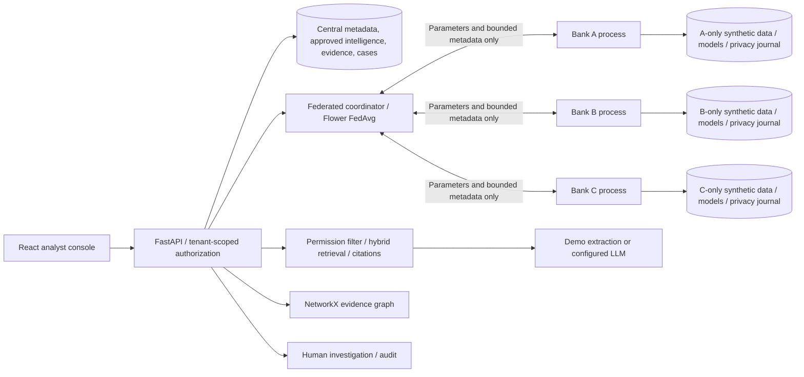
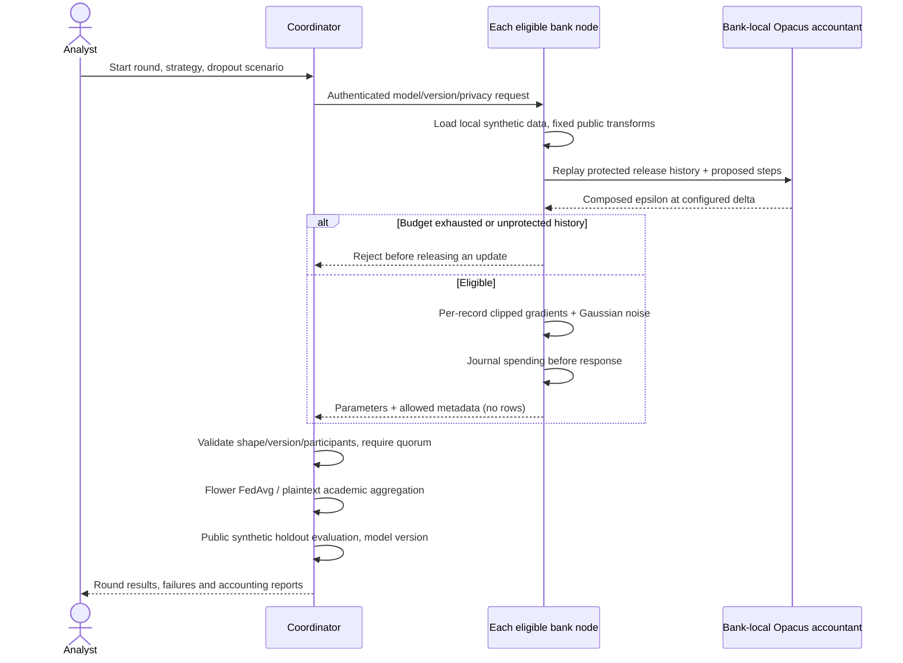

# Architecture

The native Flower runner is a separate optional transport experiment. The default dashboard workflow uses Flower's aggregation function with authenticated REST dispatch. The coordinator knows each client's update in both supplied modes. Docker enforces separate data mounts, while local processes share a host administrator; neither represents independent bank infrastructure.

Global evaluation uses generated public synthetic data, never client validation rows. All tree model benchmarks and centralized training occur in the explicitly synthetic-only evaluation script, outside the deployed coordinator path. Fixed feature scaling and missing-value defaults use public constants, never fitted local statistics. Client weights are equal public cohort weights, not hidden private sample counts.
